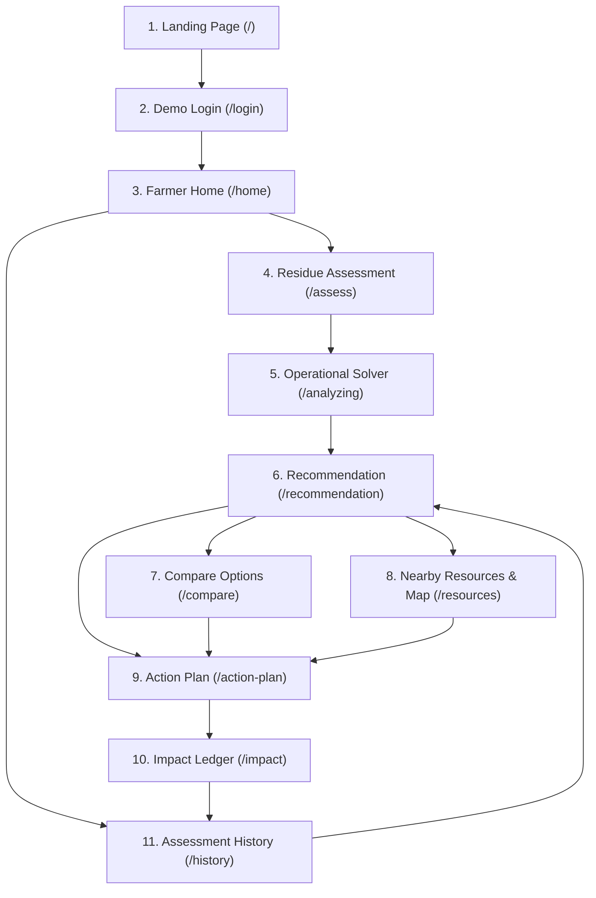

# AgriCycle — Application Flow & State Transition Specification

## 1. Complete Route Architecture

AgriCycle has a linear, guided primary workflow paired with rapid horizontal drill-down into comparison, nearby maps, action plans, and impact tracking.

---

## 2. Route by Route Specifications

### 2.1. Landing (`/`)
- **Purpose**: Ground the user in the agricultural problem ("After harvest, what happens to the residue?").
- **Key Elements**:
  - Editorial headline, crop residue crisis context in Punjab/Haryana/Western UP.
  - Primary CTA: `Assess My Residue` (routes to `/login` or directly to `/home` if already authenticated).
  - Secondary CTA: `How It Works` (scrolls to a 4-step decision breakdown: Situation → Feasibility → Machinery → Action).
  - Language toggle (`English | हिन्दी`) in header.

### 2.2. Demo Login (`/login`)
- **Purpose**: Frictionless one-click authentication for evaluation and testing.
- **Profiles Provided**:
  - `Profile 1 (Primary E2E)`: Gurpreet Singh — 8 Acres Paddy, Karnal, Haryana (Tight 12-day window, owns no heavy machinery).
  - `Profile 2`: Balwinder Singh — 15 Acres Paddy, Sangrur, Punjab (Owns standard 50HP tractor, priority: Soil health).
  - `Profile 3`: Ramesh Kumar — 6 Acres Sugarcane, Meerut, Western UP (Priority: Fast turnaround).
- **Behavior**: Clicking "Select Profile & Enter" populates local session state and redirects to `/home`.

### 2.3. Farmer Home (`/home`)
- **Purpose**: The farmer's field notebook dashboard.
- **Key Elements**:
  - Prominent Primary Action: `Start New Residue Assessment` (High-contrast, bold button).
  - Active Field Summary: Displays the most recent assessment (Crop, Acreage, Tonnage, Next Sowing countdown).
  - Ongoing Action Plan snippet: Shows checklist progress (e.g. `2 of 5 steps confirmed`).
  - Quick Links: View Assessment History, Open Local Machinery Directory.

### 2.4. Residue Assessment (`/assess`)
- **Purpose**: Collect verified operational parameters without friction.
- **Step 1: Field & Crop**:
  - Crop selector: Paddy, Wheat, Sugarcane, Maize, Other.
  - Acreage and estimated residue tonnage (auto-calculates based on regional crop yield ratios: ~2.5 tonnes straw per acre for paddy).
  - State & District dropdown (Punjab: Sangrur, Ludhiana, Patiala; Haryana: Karnal, Kaithal, Kurukshetra; UP: Meerut, Muzaffarnagar).
  - Village / Block text input.
- **Step 2: Timelines & Windows**:
  - Harvest Date (date picker).
  - Next Sowing Date (date picker).
  - Auto-computed `Available Window Days` indicator (Highlights in amber if < 10 days).
- **Step 3: Machinery & Priority**:
  - Machinery owned (None, Standard Tractor 40-50HP, Super SMS, Happy Seeder, Baler).
  - Primary Farmer Priority (Lowest Cost, Fastest Solution, Maximum Economic Value, Long-term Soil Health).
- **Validation Rules**: Harvest date must be before sowing date; residue quantity must be > 0. Submission triggers route to `/analyzing`.

### 2.5. Operational Solver / Analysis (`/analyzing`)
- **Purpose**: Give the user transparent feedback that a multi-factor constraint evaluation is executing.
- **Duration**: Crisp, purposeful 1.5 – 2.0 second sequence (not a lagging spinner).
- **Steps Evaluated & Visually Checked**:
  1. `Evaluating crop residue volume (5.0 tonnes Paddy straw)`
  2. `Analyzing sowing deadline constraint (12 days remaining)`
  3. `Checking compatible regional Custom Hiring Centres within 15 km`
  4. `Scoring cost, speed, and soil-retention trade-offs`
  5. `Synthesizing primary recommendation`
- **Transition**: Automatically navigates to `/recommendation` upon solver completion.

### 2.6. Recommendation Sheet (`/recommendation`)
- **Purpose**: Clear, unambiguous answer to "What should I do?"
- **Key Elements**:
  - Primary Recommended Pathway (e.g. `Custom Hiring Centre: Happy Seeder / Super SMS in-situ incorporation`).
  - Structured "Why this option?" rationale referencing the farmer's exact numbers (12-day window, 0 machinery owned, Karnal radius).
  - Operational Estimates Bar: Estimated Cost (₹), Operational Time (Days), Distance to nearest CHC (km).
  - Fallback/Generated AI Explanation Card: Clear natural-language bilingual summary with transparent local decision markers.
  - Navigation Buttons:
    - `Compare All Feasible Options` (to `/compare`)
    - `Find Nearby Machinery & CHCs` (to `/resources`)
    - `Build Action Plan` (Primary CTA to `/action-plan`)

### 2.7. Pathway Comparison (`/compare`)
- **Purpose**: Respect farmer autonomy. Allow full comparison of all options.
- **Structure**:
  - Comparison Table / Responsive Ledger of all 4 pathways:
    1. In-situ: CHC Super SMS + Happy Seeder sowing.
    2. Ex-situ: Baling + Delivery to Biomass Pellet Plant / Power unit.
    3. Biological: Pusa Bio-Decomposer spray + Mulching.
    4. Custom Hiring: Full service rental package.
  - Columns: Suitability Score (0–100), Estimated Net Cost (₹), Operational Time, Machinery Required, Advantages, Limitations.
  - `Select This Pathway` action button on each row to switch the active recommendation and re-bind the action plan.

### 2.8. Nearby Resources & Spatial Map (`/resources`)
- **Purpose**: Connect the decision to real-world infrastructure.
- **Key Elements**:
  - Spatial Map View (Leaflet / OpenStreetMap) showing farm location and nearby resource pins.
  - Filterable Directory list: Custom Hiring Centres, Baler Operators, Biomass Aggregators.
  - Entity Cards: Verified / Demo badge, Distance in km, Available Equipment, Operator Phone Contact, Base Hiring Rates.
  - "Book / Contact CHC" direct telephone link.

### 2.9. Interactive Action Plan (`/action-plan`)
- **Purpose**: Turn decision into concrete steps.
- **Checklist Steps**:
  1. Confirm CHC machinery availability for target date.
  2. Arrange tractor hitch / fuel requirements (if applicable).
  3. Conduct field pre-moisture check (Rauni irrigation status).
  4. Oversee machinery operation and verify uniform straw distribution.
  5. Record completion and log final cost.
- **Persistence**: Checkbox states persist in session/local storage.

### 2.10. Impact Ledger (`/impact`)
- **Purpose**: Tangible reinforcement of positive environmental and economic stewardship.
- **Metrics Tracked**:
  - Tonnes of residue diverted from open combustion.
  - Particulate Matter (PM2.5 / PM10) release prevented (standard ICAR/CPCB emission factors).
  - Soil Organic Carbon (SOC) and Nitrogen/Phosphorus/Potassium (NPK) retained in field soil.
  - Methodology Note: Transparently documents formulas used without claiming unverified carbon market credits.

### 2.11. Assessment History (`/history`)
- **Purpose**: Reference past seasons and re-run evaluations.
- **List Items**: Date, Crop, Acreage, Selected Pathway, Status (Completed / In Progress), Action link to view past plan.

---

## 3. Session State & Persistence Schema
- State is stored in a structured client-side repository (`localStorage` with reactive React context):
  - `currentAssessment`: Active form data, computed suitability scores, selected pathway ID.
  - `assessmentHistory`: Array of past assessments.
  - `actionPlanProgress`: Map of `assessmentId -> { stepId: boolean }`.
  - `currentLanguage`: `'en' | 'hi'`.
  - `currentUser`: Authenticated demo profile.
- State persists across page refreshes; refreshing on `/recommendation` or `/action-plan` does not cause state loss or crashes.
